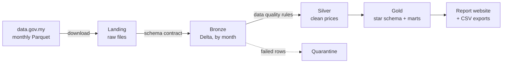

# Malaysia PriceCatcher Lakehouse

[](https://github.com/faeznizam/malaysia-pricecatcher-lakehouse/actions/workflows/ci.yml)
[](https://github.com/faeznizam/malaysia-pricecatcher-lakehouse/actions/workflows/pipeline.yml)

An automated data pipeline that turns Malaysia's open government price data
(2.7 million shop-level prices, refreshed daily) into clean, tested analysis
tables and a public report. Built with **PySpark** and **Delta Lake** in a
medallion (bronze / silver / gold) layout, scheduled with **GitHub Actions**.

**What it answers:** which states are most expensive on the same basket of
goods, which prices moved most this month (measured fairly), and how
trustworthy the source data is.

## Architecture



| Layer | What happens | Key tables |
|---|---|---|
| Landing | Raw files saved unchanged; partial downloads never kept | `data/landing/` |
| Bronze | Loaded into Delta with a schema contract and lineage columns; one month replaced at a time, so re-runs are safe | `prices`, `lookup_item`, `lookup_premise` |
| Silver | 7 data quality rules; bad rows quarantined (not deleted), minor issues tagged; prices stored as exact `DECIMAL` | `prices`, `quarantine`, `meta/dq_run_log` |
| Gold | Star schema plus analysis marts | `fact_price`, `dim_item`, `dim_premise`, `dim_date`, `mart_item_month`, `mart_item_mom`, `mart_item_group_mom`, `mart_price_trend`, `mart_state_index`, `mart_premise_type_index` |

## Results (real data, May to 26 Oct 2026)

- **Six months of prices** from about 2,150 shops for 343 items
  (September and October alone: 2,699,801 prices).
- **Price trend:** overall prices rose **1.2%** from May to October, but dry
  goods (barangan kering) rose **8.8%**, climbing every month.
- **Leafy vegetables jumped 18–46%** from September to October in the same
  shops, while tomatoes and some fruit fell. A supply shock, not a data error.
- **Shop type matters:** small grocers and wet markets are about 10% dearer
  than hypermarkets on the same items.
- **113 rows quarantined** in September and October (under 0.01%): 28 prices at 10x or more their
  item's median (typically a missing decimal point) and 85 at a tenth or less.
- **State price index**, October, on a 176-item basket (Malaysia = 100):
  W.P. Labuan was the most expensive at **109.6** and Melaka the cheapest at
  **97.1**. Sarawak, Putrajaya, Sabah and Kuala Lumpur were all above 105.
- Interpretation: [docs/findings.md](docs/findings.md).

## Engineering highlights

- **Idempotent loads:** each month is replaced as a whole with Delta's
  `replaceWhere`, so a failed or repeated run never duplicates data.
- **Schema contract:** a renamed or missing upstream column stops the load
  with a clear error instead of corrupting later tables.
- **Evidence-based data quality:** the rules come from profiling the real files
  ([docs/data_profile.md](docs/data_profile.md)); each run logs per-rule counts.
- **Fair month-on-month change:** "matched" changes compare only shops that
  reported in both months, the way official price indices avoid mix effects.
- **Unknown codes kept, not dropped:** 1.5% of prices use item codes not yet in
  the published lookup; they map to a `-1` member and stay visible.
- **Measured storage layout:** a benchmark of four layouts on the real data
  chose monthly partitions ([ADR 0001](docs/adr/0001-fact-price-layout.md)).
- **Real-world fix:** the publisher's files use Brotli compression, which Spark
  can't read; bronze re-encodes them with DuckDB first, and the tests use
  Brotli files so they match reality.
- **Automated:** tests run on every push; the full pipeline runs daily at 2pm
  Malaysia time and rebuilds the report.

## Tech stack

Python 3.14 · PySpark 4.2 · Delta Lake 4.4 · DuckDB (profiling and re-encoding)
· pytest · GitHub Actions · Java 21

## Quick start (Linux / WSL2)

Needs Python 3.14 and Java 21 (`sudo apt install -y openjdk-21-jdk-headless`).

```bash
make venv          # create .venv and install dependencies
make test          # run the unit tests (no network needed)
make download      # May 2026 to now, plus both lookups
make profile       # describe the downloaded files (optional)
make pipeline      # bronze -> silver -> gold -> report
```

Then open `site/index.html` in a browser.

Other targets: `make bronze`, `make silver`, `make gold`, `make report`,
`make benchmark`, and `make download SINCE=2025-11` or `MONTHS="2026-08"` for other months.
Raw files go to `data/landing/` (override with `LANDING_DIR`) and Delta tables
to `lake/` (override with `LAKE_ROOT`). Data is never committed.

## Project layout

```
pricecatcher/download.py    landing: fetch raw files from data.gov.my
pricecatcher/profile.py     read-only profile of the landing files (DuckDB)
pricecatcher/spark.py       shared Spark session with Delta Lake
pricecatcher/bronze.py      bronze: schema contract, lineage, idempotent monthly loads
pricecatcher/dq.py          data quality rules, one per line
pricecatcher/silver.py      silver: apply the rules, quarantine, run log
pricecatcher/gold.py        gold: star schema and marts
pricecatcher/report.py      static report website and CSV exports
pricecatcher/benchmark.py   storage layout benchmark
tests/                      unit tests for every step
.github/workflows/          CI on every push; daily pipeline
docs/                       data profile, findings, decision records, learning notes
```

## Data source and licence

Daily item prices collected by KPDN (Ministry of Domestic Trade and Cost of
Living), published by [data.gov.my](https://data.gov.my/data-catalogue/pricecatcher)
under [CC BY 4.0](https://creativecommons.org/licenses/by/4.0/).

## Possible next steps

- Adjust the state index for shop type (hypermarket vs grocer).
- Move the lake to cloud object storage (S3) and run Spark serverless.
- Keep more history to show trends across festive seasons.
