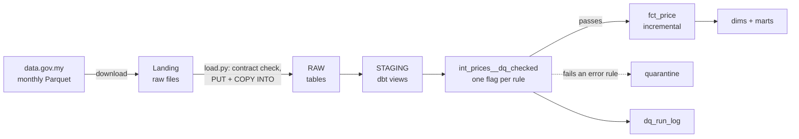

# PriceCatcher on Snowflake + dbt (the SQL path)

The same PriceCatcher data and the same rules as the PySpark lakehouse,
rebuilt the way many warehouse teams work: files loaded into Snowflake,
transformed and tested in SQL with dbt.



| Layer | What happens | Objects |
|---|---|---|
| RAW | Files loaded as published, after a schema contract check; a month is replaced in one transaction | `RAW.PRICES`, `RAW.LOOKUP_ITEM`, `RAW.LOOKUP_PREMISE` |
| STAGING | Clear names and types; premise text tidied; one row per lookup code | `stg_pricecatcher__*` views |
| Data quality | The 7 rules from the PySpark path, as one SQL flag column each | `int_prices__dq_checked` |
| MARTS | Star schema, quarantine, a per-run quality log, analysis tables | `fct_price`, `dim_item`, `dim_premise`, `dim_date`, `quarantine`, `dq_run_log`, `mart_item_month`, `mart_item_mom`, `mart_state_index`, `mart_premise_type_index` |

## Design choices

- **Load, then transform (ELT).** `load.py` only lands files in RAW. Every
  business rule lives in dbt, in SQL, under version control and tests.
- **Fail before paying for compute.** `load.py` checks each file locally with
  DuckDB first: required columns, types that cast cleanly, every row dated in
  the file's month. A bad file stops before it is uploaded.
- **Idempotent loads.** Each month is deleted and re-inserted inside one
  transaction, and `COPY INTO ... FORCE = TRUE` reloads the file even though
  Snowflake's load history has seen it. A failed run leaves the old month in place.
- **Incremental fact, month at a time.** `fct_price` rebuilds only the latest 2
  months (`reprocess_months`), because the publisher adds days to the current
  month and last month's final days arrive early in the new month. It uses
  delete+insert on `year_month`, the SQL twin of Delta's `replaceWhere`.
  A row-level MERGE would be wrong here: if a fixed rule now quarantines a
  row, a MERGE would never remove it from the fact.
- **MERGE where it fits.** The dimensions use MERGE on the code: new items are
  inserted, changed names are updated, and an item the publisher drops from
  its lookup stays, so old facts still join. `_first_seen_at` is excluded from
  the update (`merge_update_columns`), so it keeps the first load's time.
- **Rules as data.** The 7 rules are one list in `macros/dq_rules.sql`. A macro
  turns them into flag columns, the quarantine reason and the run log, so a new
  rule is one line.
- **One project, two warehouses.** dbt runs on DuckDB locally and in CI, and on
  Snowflake for real. Where SQL differs (regex functions), `tidy_text`
  dispatches to one version per adapter.
- **Pruning.** Both window functions in the quality model partition by
  `year_month`, so an incremental run's month filter lets Snowflake skip older
  data. RAW and `fct_price` are clustered by `year_month`.
- **Cost guard.** An X-Small warehouse that pauses after 60 seconds, and a
  resource monitor that suspends it at 5 credits a month.

## Tests

| Kind | What it checks |
|---|---|
| Unit tests (`dbt build` runs them first) | Each rule quarantines the right row; matched month-on-month change ignores shop mix; an incremental run selects only the recent months |
| Generic tests | Keys unique and not null, fact codes join their dimensions, one row per (date, premise, item), prices and index values in a sane range |
| Singular tests | Every raw row lands in exactly one of `fct_price` or `quarantine`; no month quarantines 1% or more |
| Source freshness | Prices loaded within 2 days (warn) or 4 days (error) |
| CI | Builds everything on DuckDB from a made-up dataset with one example of each data problem, then reloads a month and checks the row counts don't change |

## PySpark path vs SQL path

| | PySpark + Delta Lake | Snowflake + dbt |
|---|---|---|
| Where it runs | Any machine with Python and Java | Snowflake's compute; dbt only sends SQL |
| Rules written in | Python (`pricecatcher/dq.py`) | SQL generated from one Jinja list |
| Idempotent month load | Delta `replaceWhere` | DELETE + COPY INTO in a transaction; dbt delete+insert |
| Lookup changes | Full overwrite | MERGE, keeps codes the publisher drops |
| Testing | pytest on small DataFrames | dbt unit, generic and singular tests |
| Best when | Heavy Python logic, files, ML, very large data | Analysts and engineers share SQL models in a warehouse |

## Run it locally (DuckDB, no account needed)

```bash
make wh-venv                                     # its own virtual environment
make wh-sample                                   # small made-up data, or `make download` for the real files
make warehouse WH_LANDING=data/sample_landing    # load + dbt build
```

## Run it on Snowflake

1. Sign up for a free Snowflake trial (any cloud and region).
2. Make a key pair for the pipeline's service user:

   ```bash
   openssl genrsa 2048 | openssl pkcs8 -topk8 -inform PEM -out snowflake_key.p8 -nocrypt
   openssl rsa -in snowflake_key.p8 -pubout | grep -v "PUBLIC KEY" | tr -d '\n'   # the public key
   ```

3. In a Snowsight worksheet, paste the public key into `warehouse/setup.sql`
   where it says `<PUBLIC_KEY>`, and run the whole file.
4. Set the connection and run:

   ```bash
   export SNOWFLAKE_ACCOUNT=<orgname-accountname>   # from Snowsight: your account > Account details
   export SNOWFLAKE_USER=PRICECATCHER_SVC
   export SNOWFLAKE_PRIVATE_KEY_PATH=$PWD/snowflake_key.p8
   make download                                    # real files from data.gov.my
   make warehouse WH_TARGET=snowflake
   ```

5. For the daily GitHub Actions run, add the repository secrets
   `SNOWFLAKE_ACCOUNT`, `SNOWFLAKE_USER` and `SNOWFLAKE_PRIVATE_KEY` (the
   contents of `snowflake_key.p8`), set the variable `SNOWFLAKE_ENABLED=true`,
   and run the "Snowflake pipeline" workflow once with **backfill** ticked.

Never commit the `.p8` key (it is in `.gitignore`).
